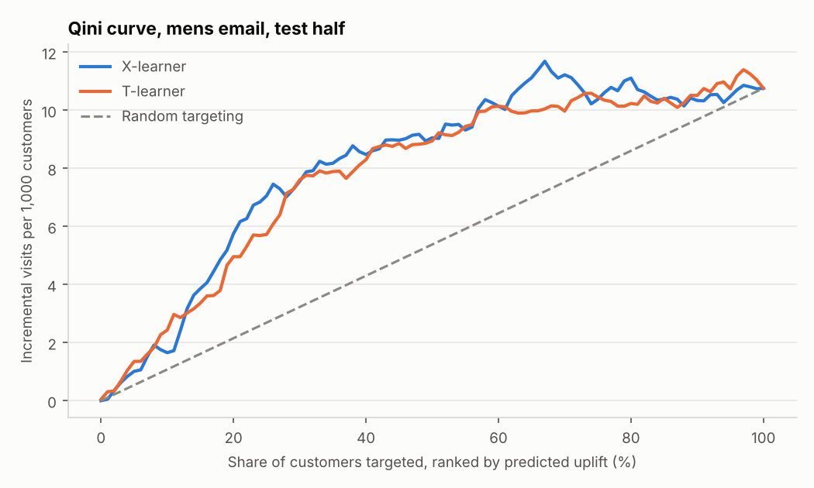
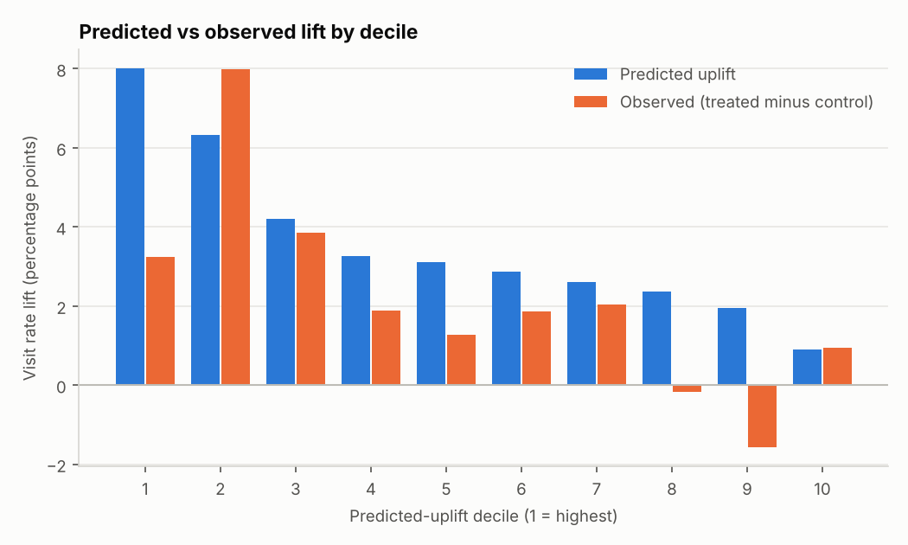
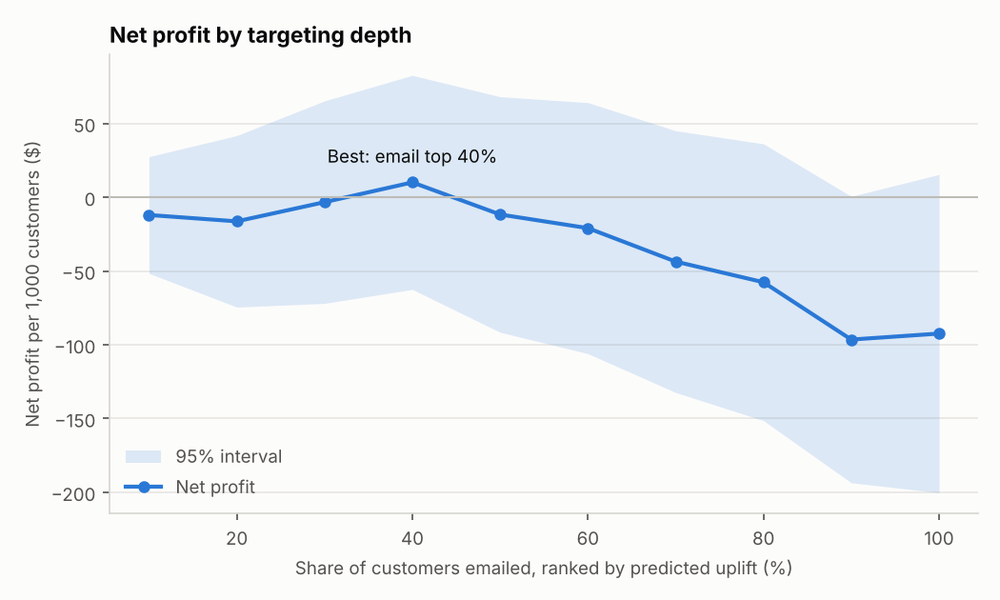
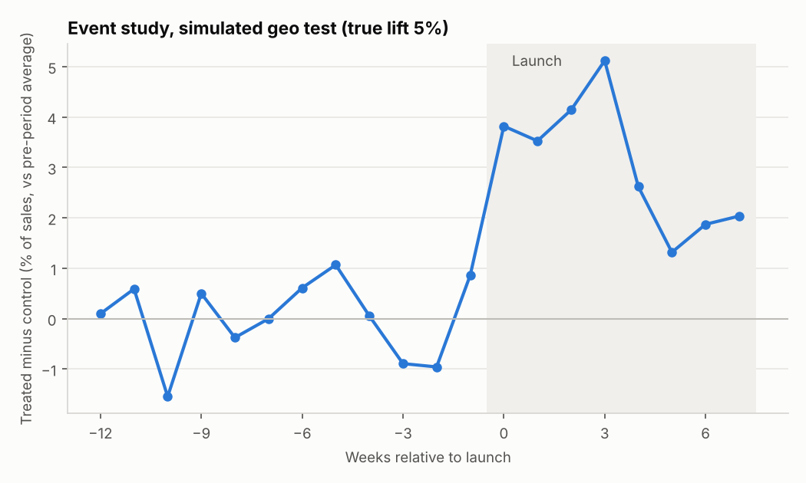

# Results

Data: SYNTHETIC data with a known treatment effect (`--synthetic`).

## 1. Randomization checks

Arm sizes: control 21,418, mens 21,350, womens 21,232. Sample ratio mismatch test against an equal split: chi-square 0.83, p = 0.660 (no SRM).

Covariate balance against control:

| arm | covariate | SMD | balanced (abs < 0.1) |
|---|---|---|---|
| mens | recency | +0.004 | yes |
| mens | history | +0.007 | yes |
| mens | mens | +0.003 | yes |
| mens | womens | +0.003 | yes |
| mens | newbie | -0.006 | yes |
| womens | recency | -0.010 | yes |
| womens | history | +0.014 | yes |
| womens | mens | -0.007 | yes |
| womens | womens | +0.000 | yes |
| womens | newbie | -0.012 | yes |

## 2. Average treatment effects

| arm | metric | control | treated | lift | 95% CI | relative | p | CUPED var. reduction | significant after BH |
|---|---|---|---|---|---|---|---|---|---|
| mens | visit | 0.0895 | 0.1182 | +2.87 pp | [+2.289, +3.445] | 32.0% | <0.001 | 0.0% | yes |
| mens | conversion | 0.0088 | 0.0108 | +0.20 pp | [+0.017, +0.391] | 23.3% | 0.032 | 0.0% | yes |
| mens | spend | 1.1546 | 1.3190 | +$0.164 | [-0.113, +0.442] | 14.2% | 0.246 | 0.0% | no |
| womens | visit | 0.0895 | 0.1274 | +3.79 pp | [+3.196, +4.374] | 42.3% | <0.001 | 0.0% | yes |
| womens | conversion | 0.0088 | 0.0113 | +0.25 pp | [+0.063, +0.442] | 28.8% | 0.009 | 0.0% | yes |
| womens | spend | 1.1546 | 1.3391 | +$0.185 | [-0.095, +0.464] | 16.0% | 0.195 | 0.0% | no |

Spend is zero for most customers and heavy-tailed among buyers, so the mens spend effect gets three extra reads: bootstrap 95% CI [-0.113, +0.464]; winsorized at the 99th percentile +0.450 (p = <0.001); Mann-Whitney p = 0.033. CUPED uses pre-period `history` spend as the covariate; its variance reduction is small here because last year's spend predicts a two-week window weakly.

## 3. Who responds: uplift modeling for the mens email (outcome: visit)

Trained on a random half, evaluated on the other half. Qini coefficient (area between the model's cumulative incremental-visit curve and random targeting; higher is better):

| model | Qini (x1000) |
|---|---|
| X-learner | 2.74 |
| T-learner | 2.48 |
| Random | 0.64 |

Because the data are simulated, the true individual effect is known. Correlation of predicted with true uplift: X-learner 0.77, T-learner 0.73.

Predicted and observed lift by X-learner decile (test half):

| decile | predicted | observed | n |
|---|---|---|---|
| 1 | +8.01 pp | +3.23 pp | 2,128 |
| 2 | +6.32 pp | +8.00 pp | 2,127 |
| 3 | +4.20 pp | +3.85 pp | 2,127 |
| 4 | +3.27 pp | +1.89 pp | 2,127 |
| 5 | +3.11 pp | +1.28 pp | 2,127 |
| 6 | +2.87 pp | +1.87 pp | 2,127 |
| 7 | +2.61 pp | +2.04 pp | 2,127 |
| 8 | +2.37 pp | -0.16 pp | 2,127 |
| 9 | +1.96 pp | -1.58 pp | 2,127 |
| 10 | +0.89 pp | +0.95 pp | 2,127 |

## 4. Who should get the email? (cost $0.10/email, margin 30%)

| share emailed | incremental spend per emailed customer | net profit per 1,000 customers | 95% interval |
|---|---|---|---|
| 10% | $-0.068 | -$12 | [-$52, $27] |
| 20% | $0.061 | -$16 | [-$74, $42] |
| 30% | $0.296 | -$3 | [-$72, $65] |
| 40% | $0.417 | $10 | [-$62, $83] |
| 50% | $0.255 | -$12 | [-$92, $68] |
| 60% | $0.217 | -$21 | [-$106, $64] |
| 70% | $0.126 | -$44 | [-$132, $45] |
| 80% | $0.093 | -$58 | [-$151, $36] |
| 90% | $-0.024 | -$96 | [-$194, $1] |
| 100% | $0.025 | -$92 | [-$200, $15] |

Sensitivity of the decision to email cost:

| cost per email | best share to email | profit per 1,000 |
|---|---|---|
| $0.05 | 40% | $30 |
| $0.10 | 40% | $10 |
| $0.20 | 10% | -$22 |
| $0.30 | 10% | -$32 |

## 5. When you cannot randomize people: a simulated geo holdout

Fifty markets, twelve launch a campaign after week 12, and the true lift is 5.0% of sales. Markets differ in level, trend and seasonal sensitivity, so any single test is noisy.

- DiD with all 38 control markets: 3.10% [0.91%, 5.29%]
- DiD with 17 path-matched controls: 3.06% [0.64%, 5.47%]
- Placebo test (300 fake launches among control markets): p = <0.001

Is the estimator trustworthy beyond one draw? 150 independent simulated tests per estimator:

| estimator | mean estimate | bias | SD across tests | 95% CI coverage |
|---|---|---|---|---|
| All controls | 5.10% | +0.10 pp (SE 0.08) | 0.93% | 95% |
| Matched on pre-period correlation | 5.49% | +0.49 pp (SE 0.07) | 0.92% | 95% |
| Matched on pre-period distance (default) | 5.08% | +0.08 pp (SE 0.07) | 0.88% | 97% |

Matching on correlation looks sensible and is biased. Correlation ignores scale, so it picks controls with strong seasonal swings; the post period falls in a seasonal dip, those controls dip harder than the treated markets, and the lift is overstated. Matching on squared distance between demeaned paths requires controls to move by the same amount, and the bias disappears.
